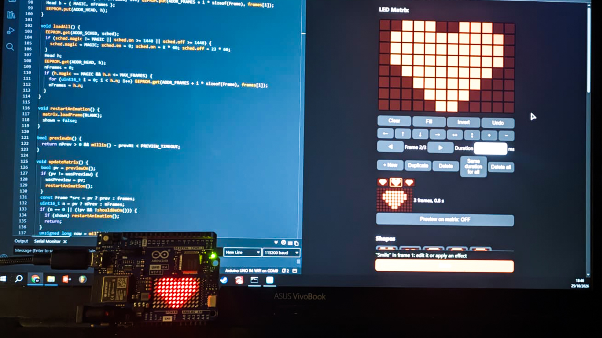

# LED Matrix Studio

<p align="center">
  
</p>

Create animations for the 12×8 LED matrix of the **Arduino UNO R4 WiFi** from a web page served by the board itself. Draw pixel by pixel, use ready-made shapes and animations, type scrolling text with emoji, import GIF/SVG/images and watch the result live on the matrix.

No app, no cloud, no SD card: everything runs on the board and in your browser.

## Features

- **Pixel editor**: tap or drag to draw, with undo, move, mirror, flip and zoom tools
- **Frames**: add, duplicate, delete, set the duration of each frame, live preview in the page
- **Shapes**: heart, smile, star, sun, moon, flower, cat, ghost, invader, Pac-man and more
- **Ready-made animations**: beating heart, Pac-man, rain, snow, wave, fireworks, eyes, ECG, loading spinner…
- **Animated text**: scroll left/right, one letter at a time or still, with small or big animated emoji (❤️ 😀 🔥 ⭐ 🐱 …)
- **Effects**: heartbeat, breathe, blink, spin, scroll, bounce, shake, sparkle, wipe, dissolve
- **Import**: animated GIF, SVG, PNG, JPG, WebP
- **Live preview**: see every change on the matrix while you edit, without saving
- **Schedule**: turn the matrix on and off automatically, with daylight saving time
- **Persistent**: animation and schedule survive a power cycle
- Works from desktop and mobile browsers

## Requirements

- Arduino UNO R4 WiFi
- [Arduino IDE 2.x](https://www.arduino.cc/en/software) with the **Arduino UNO R4 Boards** package (Tools → Board → Boards Manager). It already includes the `WiFiS3` and `Arduino_LED_Matrix` libraries, nothing else to install.
- A **2.4 GHz** Wi-Fi network (the board does not support 5 GHz)

## Quick start

1. Download the repository and make sure the folder is named **`matrix`**: the Arduino IDE requires the folder name to match the sketch name (`matrix.ino`).
2. Copy `config.example.h` to **`config.h`** in the same folder and fill in your network (see [Configuration](#configuration)).
3. Open `matrix.ino`, select **Arduino UNO R4 WiFi** as the board and upload.
4. Open the Serial Monitor at **115200** baud: it prints the address to open.
5. Open `http://<STATIC_IP>` (for example `http://192.168.1.50`) from any device on the same network.

## Configuration

All settings live in `config.h`. This file is listed in `.gitignore`, so your Wi-Fi password never ends up on GitHub.

```cpp
const char *WIFI_SSID = "your-network";
const char *WIFI_PASS = "your-password";

const IPAddress STATIC_IP(192, 168, 1, 50);
const IPAddress GATEWAY(192, 168, 1, 1);
const IPAddress SUBNET(255, 255, 255, 0);
const IPAddress DNS(192, 168, 1, 1);

const int OFFSET_WINTER = 3600;
const int OFFSET_SUMMER = 7200;
```

| Setting | What to put |
|---------|-------------|
| `WIFI_SSID`, `WIFI_PASS` | Name and password of your 2.4 GHz network |
| `GATEWAY` | Your router's address. On Windows run `ipconfig` and look for *Default Gateway*; on macOS/Linux run `ip route` or check the network settings |
| `STATIC_IP` | A free address in the same network as the gateway (same first three numbers), **outside the router's DHCP range** so no other device gets it. The board always uses this address, so you can bookmark the page |
| `SUBNET` | Almost always `255.255.255.0` |
| `DNS` | Usually the same as the gateway. It is needed to get the time from the internet |
| `OFFSET_WINTER`, `OFFSET_SUMMER` | Your time zone in seconds from UTC, in winter and in summer. The defaults are for Central Europe (UTC+1 / UTC+2) |

> Daylight saving time follows the **European rule** (last Sunday of March to last Sunday of October). For a time zone without daylight saving, set both offsets to the same value.

If you forget to create `config.h`, compilation stops with a message telling you to do it.

## How to use

1. **Draw** on the grid, or pick a **shape**, a **ready-made animation**, some **animated text**, or **import** a file.
2. Build your sequence with the frame buttons and apply **effects** to the current frame. Tick *Append* to add new frames after the existing ones instead of replacing them.
3. Turn on **Preview on matrix** to see every change live on the board.
4. Optionally set the **schedule** (turn on / turn off time).
5. Press **Save** in the bottom bar: the animation and the schedule are stored on the board.

**Delete all** clears every frame and **Undo** (or Ctrl+Z) restores them. Up to 100 frames are supported.

## How it works (fun facts)

- **One page, one string.** The whole web app (editor, GIF decoder, font, emoji, animations) is a single ~33 KB string stored in the board's flash memory and sent to the browser on request.
- **All the heavy work happens in your browser.** GIFs are decoded by a small hand-written LZW decoder, SVGs and images are drawn on a canvas and reduced to 12×8 pixels. The board only ever receives on/off pixels.
- **96 LEDs = 3 numbers.** Each frame is 96 bits, sent as 24 hex characters plus 4 for its duration in milliseconds. A full 100-frame animation is just 2.8 KB of text.
- **Saved in EEPROM.** The animation and the schedule are written to the board's emulated EEPROM, so they come back after a power cycle.
- **A 3×5 pixel font.** Every letter is described by five digits, one per row, where each digit encodes three pixels. Emoji are hand-drawn at 5×5 to match the letters, and most have a second frame so they can animate. Emoji without a drawing are turned into their silhouette.
- **Preview without wearing out the memory.** The live preview lives only in RAM. The page sends a "ping" every 2 seconds, and if it stops (you closed the page) the board goes back to the saved animation after 6 seconds.
- **Why `page.h`?** The Arduino IDE scans `.ino` files to generate function prototypes and inserts `#line` markers. It does not understand C++ raw strings, so it used to inject those markers right into the JavaScript and break the page. Header files are never touched, so the page lives there.
- **The time comes from the Wi-Fi module**, which gets it from the internet. Daylight saving is calculated on the board, so no time-zone library is needed.

## Project structure

| File | Content |
|------|---------|
| `matrix.ino` | Wi-Fi, web server, matrix playback, schedule, EEPROM storage |
| `page.h` | The web interface (HTML, CSS, JavaScript) |
| `config.example.h` | Settings template, copy it to `config.h` |
| `config.h` | Your settings (not committed) |
| `docs/` | Images for this README |

## HTTP endpoints

| Method | Path | Description |
|--------|------|-------------|
| GET | `/` | Web interface |
| POST | `/upload` | Save the animation |
| POST | `/preview` | Show a temporary animation (not saved) |
| GET | `/ping` | Keep the preview alive |
| POST | `/stop` | End the preview |
| GET | `/frames` | Read the saved animation |
| GET | `/sched?en=&on=&off=` | Save the schedule (`on`/`off` in minutes from midnight) |
| GET | `/state` | Schedule and current board time |

## Troubleshooting

- **The board does not connect**: check that the network is 2.4 GHz and that SSID and password in `config.h` are correct. The Serial Monitor shows what is happening.
- **"This site can't be reached" / timeout**: make sure your device is on the same network and that `STATIC_IP` is in the same range as your router. VPNs such as Tailscale can capture `192.168.x.x` traffic: disconnect them or disable their subnet routes.
- **The page shows "Loading..." or "Error: …"** in the bottom bar: that message tells you what went wrong in the browser.
- **The schedule is ignored**: the board must first get the time from the internet. Until then the page shows "Time not synced yet". Check the `DNS` setting.
- **The IDE asks to move `matrix.ino` into a folder**: the folder must be named `matrix`. Accept, or rename the folder yourself.

---

<p align="center">Developed by <a href="https://denilson.it">Denilson</a> with ❤️</p>
